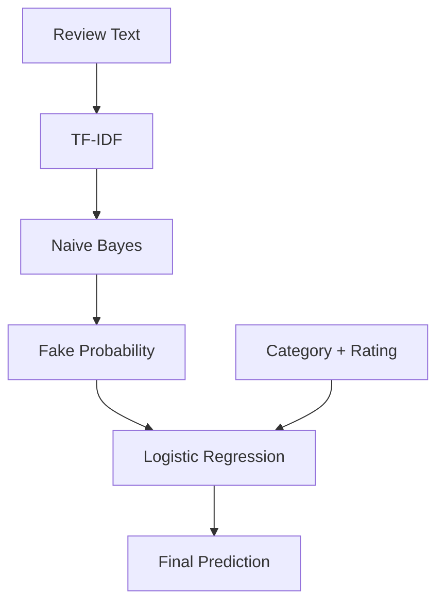

# 🕵️ Fake Review Detection

<p align="center">
  
  
  
  
</p>

> A machine learning project that classifies product reviews as **Fake (CG)** or **Genuine (OR)** using review text, product category, and rating.

## ⚡ How It Works



## 🧠 Why Two Models?

- **Naive Bayes:** Efficient text classification using word probabilities.
- **Logistic Regression:** Combines the Naive Bayes probability with category and rating to make the final prediction.

## 🛠️ Tech Stack

`Python` · `Pandas` · `Scikit-learn` · `TF-IDF` · `MultinomialNB` · `LogisticRegression`

## 📊 Model Performance

| Metric | CG | OR |
|:---|:---:|:---:|
| Precision | 0.86 | 0.86 |
| Recall | 0.86 | 0.86 |
| F1-score | 0.86 | 0.86 |
| Support | 4,044 | 4,043 |

**Overall accuracy: 86%** · Test samples: 8,087

## 🔍 Example Prediction

**Input**
- Category: `Electronics_4`
- Rating: `2`
- Review: `Good battery life but poor quality`

**Output**
```text
Naive Bayes fake probability: 49.38%
Final Prediction: FAKE REVIEW
```

## 🚀 Run Locally

```bash
pip install pandas scikit-learn
python main.py
```

Place `fake_reviews.csv` in the project directory and update the script or filename if needed.

<details>
<summary>📌 Future Improvements</summary>

- Compare both models independently.
- Improve fake-review recall and F1-score.
- Experiment with additional text and reviewer features.
- Build a Flask web interface.

</details>

<details>
<summary>⚠️ Important Note</summary>

A model prediction does not prove that a review is fake. Results depend on dataset quality and generalization to unseen reviews.

</details>

---

<p align="center">Built to explore NLP, probabilistic learning, and model combination. ⭐</p>
